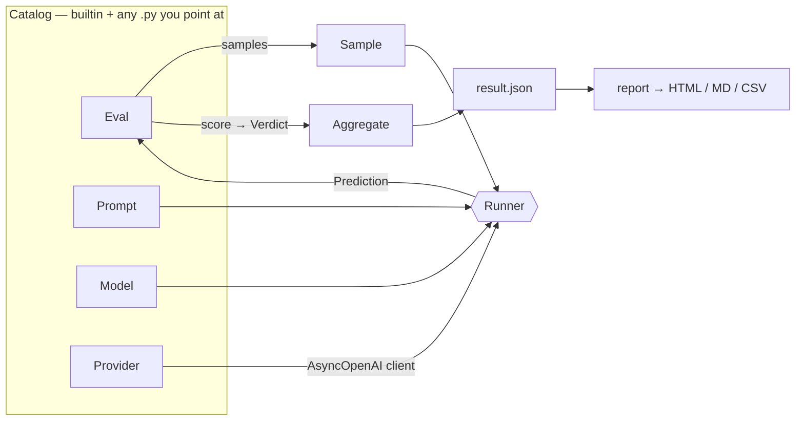

# Evals

Accuracy benchmarking for OCR and document VLMs. `vlmbench run` measures speed; `vlmbench eval` measures whether the output is *right*.

```bash
uvx vlmbench eval -d olmocr-bench -m zai-org/glm-ocr --limit 10
```

## Concepts

| Concept | What it is | Where it lives |
|---|---|---|
| **Eval** | A dataset plus how to score it — `samples()` and `score()` | `vlmbench/evals/*.py` or your own `.py` |
| **Sample** | One page: media, split, ground truth, prompt context | yielded by `Eval.samples()` |
| **Prompt** | Model-agnostic prompt text. Swept as a cross product | a catalog file |
| **Model** | Request mechanics for one model id — carries no prompt | `vlmbench/models.py` or a catalog file |
| **Provider** | Where requests go, plus optional hooks | `vlmbench/providers.py` or a catalog file |
| **Verdict** | `(column, value)` — `bool` counts a test, `float` averages, `None` is unsupported | yielded by `Eval.score()` |

- A **row** on the leaderboard is one `(provider, model, prompt)` triple.
- A **column** is either boolean (a pass rate) or continuous (a mean), never both.
- `None` means *not measured*, and is reported separately from a score of zero.



## Suites

| `-d` | Dataset | Scale | Columns |
|---|---|---|---|
| `parsebench` | `hf://datasets/llamaindex/ParseBench` | 1,509 pages | content, noise, text, order, tables, layout |
| `olmocr-bench` | `hf://datasets/allenai/olmOCR-bench` | 1,403 pages | present, absent, order, tables, baseline |
| `omni-parse-bench` | `hf://datasets/datalab-to/omni_parse_bench` | 2,937 pages | present, order, repeat, tables |

- Short name or full `hf://` ref both work; the full ref is always what gets recorded.
- Pin a revision with `@`: `-d parsebench@3f9ab12`.
- Not implemented yet, reported as `unsupported` rather than scored: olmOCR `math`, ParseBench charts and formatting, omni `layout_kind`.

## Progressive examples

### 1 — One model on a suite

```bash
vlmbench eval -d olmocr-bench -m zai-org/glm-ocr --limit 10 --stratify
```

- `-p` defaults to `vlmrun` (the gateway), so the provider can be left off.
- `--limit 10` or `--limit 1%` for a fast signal; `--stratify` spreads it across splits.
- Any limited run is branded **PARTIAL** everywhere and is not comparable to published numbers.
- Responses are cached on disk by a fingerprint of provider, model, prompt text, `extra_body` and sample — so a re-run costs nothing and an edited prompt misses the cache.
- `--no-cache` re-requests everything; `--score-only` re-scores cached output with no network at all.

### 2 — Several models, mixed providers

```bash
vlmbench eval -d olmocr-bench --limit 10 \
  -m vlmrun::zai-org/glm-ocr \
  -m vlmrun::paddlepaddle/paddleocr-vl \
  -m openrouter::qwen/qwen3-vl-8b-instruct
```

- `-m <provider>::<model_id>` — split on the **first** `::` only, so `vlmrun::vlm-run/ocr:auto` and `ollama::qwen3-vl:8b` work.
- `-m all` expands to the provider's catalog, filtered to OCR-capable models.
- `--dry-run` prints the matrix and request count before spending anything.

### 3 — Custom prompts

```python
# prompts/ocr.py
from vlmbench import Prompt

class Anchored(Prompt):
    text = "Raw text layer:\n---\n{anchor_text}\n---\nReturn clean markdown."

class Plain(Prompt):
    text = "Return the page as clean markdown, preserving reading order."
```

```bash
vlmbench eval -d olmocr-bench -c prompts/ocr.py -m vlmrun::qwen/qwen3.8-27b --limit 10
```

- Prompts name no model, so the same object runs on any provider — the recorded `sha256` proves two rows used identical text.
- Every loaded prompt is swept: 1 model × 2 prompts = 2 rows. Models with `takes_prompt = False` get one row and no prompt.
- Narrow by pointing at less: `-c prompts/ocr.py:Anchored`.
- `{placeholders}` interpolate from `Sample.context`; escape literal braces as `{{`.

### 4 — Custom provider

```python
# catalog/fireworks.py
from vlmbench import Provider

class Fireworks(Provider):
    name = "fireworks"
    base_url = "https://api.fireworks.ai/inference/v1"
    api_key_env = "FIREWORKS_API_KEY"
    concurrency = 4
```

```bash
vlmbench eval -d olmocr-bench -c catalog/fireworks.py -m fireworks::qwen/qwen3-vl-8b --limit 10
```

Optional hooks, each with a working OpenAI-compatible default:

| Hook | Default | Override when |
|---|---|---|
| `request_kwargs(subject, sample)` | `{}` | the provider needs routing or vendor params |
| `cost_usd(usage)` | reads `usage.cost` | cost arrives somewhere else |
| `list_models(client)` | `GET /models` | `-m all` should be filtered |

### 5 — Custom model mechanics

```python
# catalog/models.py
from vlmbench import Model

class MyOcr(Model):
    model = "acme/my-ocr-1b"
    takes_prompt = False          # image alone; the prompt is ignored
    extra_body = {"method": "markdown"}
```

- Only needed for models with quirks. A bare `-m acme/my-ocr-1b` works with defaults.
- Model ids match **normalized** (lowercase, `_ : .` folded), so provider casing differences don't matter.
- Merge order, later wins: `Provider.request_kwargs()` → `Model.extra_body` → `--extra-body`.

### 6 — Your own eval

```python
# catalog/invoices.py
import json

from vlmbench import Eval, Sample

class AcmeInvoices(Eval):
    name = "acme-invoices"
    dataset = "hf://datasets/acme/invoices-bench"
    prompt = "Extract invoice_number, date and total as JSON."

    def samples(self):
        for row in self.hf_rows():
            yield Sample(id=row["id"], media=row["image"], truth=row["gold_fields"])

    def score(self, sample, output):
        got = json.loads(output)
        for field, expected in sample.truth.items():
            yield field, str(got.get(field, "")).strip() == str(expected).strip()
```

```bash
vlmbench eval -d catalog/invoices.py -m vlmrun::zai-org/glm-ocr --limit 10
```

- Yielded column names become leaderboard columns — the report needs no changes.
- `Sample.media` may be a data URI, an http(s) URL, `text:...`, or `path/in/repo.pdf#2` which is downloaded, rendered and cached.

### 7 — Report

```bash
vlmbench report ~/.vlmbench/evals/*/result.json -o board.html
vlmbench report ~/.vlmbench/evals/*/result.json --format md
```

- Bands: **≥ 85** strong, **≥ 70** adequate, **< 70** weak — per-eval via `thresholds`.
- Cost is reported as **$/1K pages**.
- Partial and full runs will not share a table without `--mixed`.

## Loading catalogs

| Source | Loaded |
|---|---|
| builtin | always |
| `~/.vlmbench/catalog/*.py` | always |
| `$VLMBENCH_CATALOG` | always (`:`-separated) |
| `-c <file \| dir \| file.py:Class>` | per run, repeatable |

- One file may define any mix of `Eval`, `Model`, `Prompt` and `Provider`; subclassing registers it.
- A user entry shadows a builtin of the same name, and says so in the run header.
- `vlmbench eval --list` prints everything loaded with its origin.

## Output

```
~/.vlmbench/evals/<suite>-<id>/
  result.json          totals, per-row scores, perf, cost, resolved prompt + sha256
  outputs/<row>/*.md   raw model output for this run
~/.vlmbench/cache/<fingerprint>.md    shared response cache across runs
~/.vlmbench/corpora/<suite>/          rendered pages
```

- Every run prints samples, total cost, total request time, p50 latency, cache hits and errors.
- Cost comes from the provider's `usage.cost`; local serving reports `—`, never an imputed number.
- Secrets are redacted before anything is written.

## Not implemented

- `--judge` raises `NotImplementedError`.
- olmOCR `math`, ParseBench charts and formatting, omni `layout_kind` report `unsupported` instead of scoring.
