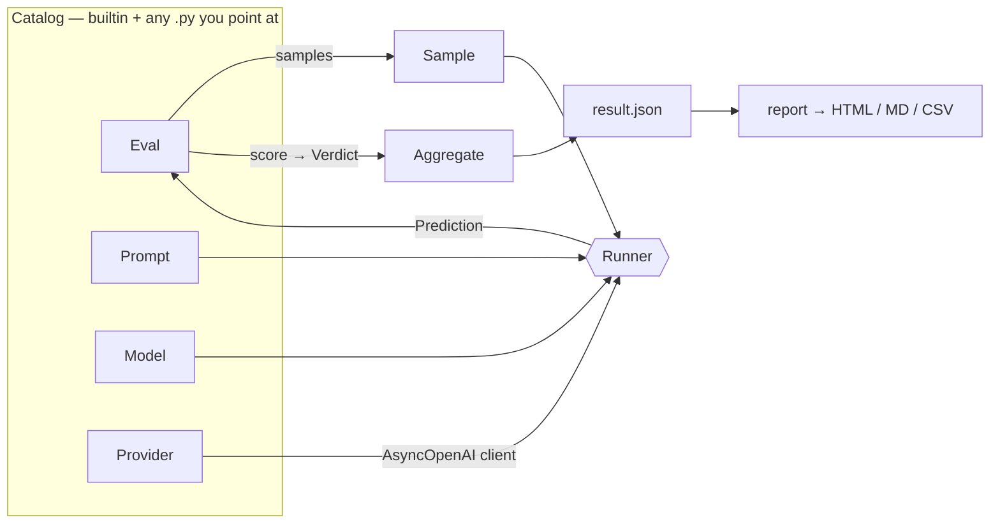
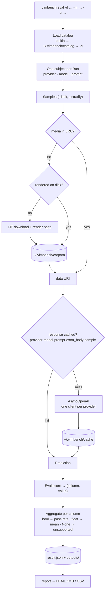

# Evals

Accuracy benchmarking for OCR and document VLMs. `vlmbench run` measures speed; `vlmbench eval` measures whether the output is *right*.

```bash
uvx vlmbench eval -d olmocr-bench -m zai-org/glm-ocr --limit 10
```

## Concepts

| Concept | What it is | Where it lives |
|---|---|---|
| **Eval** | A dataset plus how to score it — `samples()` and `score()` | `vlmbench/evals/*.py` or your own `.py` |
| **Sample** | One page: media, split, ground truth, prompt context | yielded by `Eval.samples()` |
| **Prompt** | Model-agnostic prompt text, named per row | a prompt file |
| **Run** | One declared row: model, optional provider and prompt | a run file |
| **Model** | Request mechanics for one model id — carries no prompt | `vlmbench/models.py` or a catalog file |
| **Provider** | Where requests go, plus optional hooks | `vlmbench/providers.py` or a catalog file |
| **Verdict** | `(column, value)` — `bool` counts a test, `float` averages, `None` is unsupported | yielded by `Eval.score()` |

- A **row** on the leaderboard is one `Run`: a `(provider, model, prompt)` triple.
- A **column** is either boolean (a pass rate) or continuous (a mean), never both.
- `None` means *not measured*, and is reported separately from a score of zero.



### Run flow



## Suites

| `-d` | Dataset | Scale | Columns |
|---|---|---|---|
| `parsebench` | `hf://datasets/llamaindex/ParseBench` | 1,509 pages | content, noise, text, order, tables, layout |
| `olmocr-bench` | `hf://datasets/allenai/olmOCR-bench` | 1,403 pages | present, absent, order, tables, baseline |
| `omni-parse-bench` | `hf://datasets/datalab-to/omni_parse_bench` | 2,937 pages | present, order, repeat, tables |
| `omnidocbench` | `hf://datasets/opendatalab/OmniDocBench` | 1,651 pages | text, order, tables |

- Short name or full `hf://` ref both work; the full ref is always what gets recorded.
- Pin a revision with `@`: `-d parsebench@3f9ab12`. Unpinned runs record the run date (`YY-MM-DD`) as the revision.
- Not implemented yet, reported as `unsupported` rather than scored: olmOCR `math`, ParseBench charts and formatting, omni-parse `layout_kind`, OmniDocBench `equations`.
- OmniDocBench is annotation-based rather than rule-based: each block's text must appear, in reading order. Headers, footers and page numbers are excluded, since models are routinely asked to drop them.

## Progressive examples

### 1 — One model on a suite

```bash
vlmbench eval -d olmocr-bench -m zai-org/glm-ocr --limit 10 --stratify
```

- `-p` defaults to `vlmrun` (the gateway), so the provider can be left off.
- `--limit 10`, `--limit 1%` or `--limit 0.5%` for a fast signal; `--stratify` spreads it across splits.
- Any limited run is branded **PARTIAL** everywhere and is not comparable to published numbers.
- Responses are cached on disk by a fingerprint of provider, model, prompt text, `extra_body` and sample — so a re-run costs nothing and an edited prompt misses the cache.
- `--no-cache` re-requests everything; `--score-only` re-scores cached output with no network at all.

### 2 — Several models, mixed providers

```python
# runs/ocr.py
from prompts.ocr import Anchored

from vlmbench import Run

RUNS = [
    Run(model="zai-org/glm-ocr"),
    Run(model="paddlepaddle/paddleocr-vl-1.6"),
    Run(model="qwen/qwen3.8-27b", prompt=Anchored),
    Run(provider="openrouter", model="qwen/qwen3-vl-8b-instruct", prompt=Anchored),
]

SMOKE = [Run(model="zai-org/glm-ocr")]
```

```bash
vlmbench eval -d olmocr-bench -m runs/ocr.py --limit 10
vlmbench eval -d olmocr-bench -m runs/ocr.py:SMOKE --limit 10
```

- A run file declares `RUNS`; `-m file.py:NAME` picks any other list in it.
- Rows run in the order written. Nothing multiplies — a row exists because someone wrote that line.

- `-m` is one model id, or a run file. `-p` picks the provider for the whole run; a `Run` may override it.
- `vlmbench eval --list-models -p vlmrun` prints the ids that provider serves.
- `--dry-run` prints the matrix and request count before spending anything.

### 3 — Custom prompts

```python
# prompts/ocr.py
from vlmbench import Prompt

class Anchored(Prompt):
    text = "Raw text layer:\n---\n{anchor_text}\n---\nReturn clean markdown."

class Plain(Prompt):
    text = "Return the page as clean markdown, preserving reading order."
```

```bash
vlmbench eval -d olmocr-bench -m qwen/qwen3.8-27b --prompt prompts/ocr.py:Anchored --limit 10
```

- `--prompt` takes a registered name or a `path.py:Name` reference, and applies to a single `-m` model. A run file carries its own prompts instead.
- Prompts name no model, so the same object runs on any provider — the recorded `sha256` proves two rows used identical text.
- Omit the prompt to use the eval's default. Naming one for a `takes_prompt = False` model is an error.
- `{placeholders}` interpolate from `Sample.context`; escape literal braces as `{{`.

Two prompts ship built in, as a measured baseline for what wording is worth:

| Name | Tokens | Text |
| ---- | -----: | ---- |
| `markdown` | 6 | `Convert this page to markdown.` |
| `markdown-tuned` | 62 | one clause per column the suites score weakest |

```bash
vlmbench eval -d parsebench -m qwen/qwen3.8-27b --prompt markdown
vlmbench eval -d parsebench -m qwen/qwen3.8-27b --prompt markdown-tuned
```

Token counts are measured against the model's own tokenizer by diffing
`usage.prompt_tokens`, not estimated.

### 4 — Custom provider

```python
# catalog/fireworks.py
from vlmbench import Provider

class Fireworks(Provider):
    name = "fireworks"
    base_url = "https://api.fireworks.ai/inference/v1"
    api_key_env = "FIREWORKS_API_KEY"
    concurrency = 4
```

```bash
vlmbench eval -d olmocr-bench -c catalog/fireworks.py -p fireworks -m qwen/qwen3-vl-8b --limit 10
```

Optional hooks, each with a working OpenAI-compatible default:

| Hook | Default | Override when |
|---|---|---|
| `request_kwargs(subject, sample)` | `{}` | the provider needs routing or vendor params |
| `cost_usd(usage)` | reads `usage.cost` | cost arrives somewhere else |
| `list_models(client)` | `GET /models` | `-m all` should be filtered |

### 5 — Custom model mechanics

```python
# catalog/models.py
from vlmbench import Model

class MyOcr(Model):
    model = "acme/my-ocr-1b"
    takes_prompt = False          # image alone; the prompt is ignored
    extra_body = {"method": "markdown"}
```

- Only needed for models with quirks. A bare `-m acme/my-ocr-1b` works with defaults.
- Model ids match **normalized** (lowercase, `_ : .` folded), so provider casing differences don't matter.
- Merge order, later wins: `Provider.request_kwargs()` → `Model.extra_body` → `--extra-body`.

### 6 — Your own eval

```python
# catalog/invoices.py
import json

from vlmbench import Eval, Sample

class AcmeInvoices(Eval):
    name = "acme-invoices"
    dataset = "hf://datasets/acme/invoices-bench"
    prompt = "Extract invoice_number, date and total as JSON."

    def samples(self):
        for row in self.hf_rows():
            yield Sample(id=row["id"], media=row["image"], truth=row["gold_fields"])

    def score(self, sample, output):
        got = json.loads(output)
        for field, expected in sample.truth.items():
            yield field, str(got.get(field, "")).strip() == str(expected).strip()
```

```bash
vlmbench eval -d catalog/invoices.py -m zai-org/glm-ocr --limit 10
```

- Yielded column names become leaderboard columns — the report needs no changes.
- `Sample.media` may be a data URI, an http(s) URL, `text:...`, or `path/in/repo.pdf#2` which is downloaded, rendered and cached.

### 7 — Report

```bash
vlmbench report ~/.vlmbench/evals/*/result.json -o board.html   # baked, and imports more
vlmbench report ~/.vlmbench/evals/*/result.json --format md     # for a PR body
vlmbench report --viewer -o viewer.html                         # empty page, drop files in
```

- The HTML page renders from embedded `result.json` documents, so you can **drop more result files onto it** to add rows. Nothing leaves the browser.
- Re-dropping the same run is ignored (deduped on `run_id`); click any column header to sort; a Suite column appears once more than one suite is loaded.
- Repeat runs of the same suite + provider + model + prompt collapse into one row: the newest is shown, older ones sit behind a **+N older** toggle. Every row carries the date it was evaluated.
- `--viewer` emits the same page with no runs baked in — keep one around and feed it whatever you produce.

- Bands: **≥ 85** strong, **≥ 70** adequate, **< 70** weak — per-eval via `thresholds`.
- Cost is reported as **$/1K pages**.
- Partial and full runs will not share a table without `--mixed`.

## Loading catalogs

| Source | Loaded |
|---|---|
| builtin | always |
| `~/.vlmbench/catalog/*.py` | always |
| `$VLMBENCH_CATALOG` | always (`:`-separated) |
| `-c <file \| dir \| file.py:Class>` | per run, repeatable |

Files load by **ordinary import** — `runs/ocr.py` is imported as `runs.ocr`, with the working directory on `sys.path`. So `from prompts.ocr import Anchored` inside a run file works, tracebacks are normal, and a class imported twice is the same class.

- One file may define any mix of `Eval`, `Model`, `Prompt` and `Provider`; subclassing registers it.
- Registration makes something *available*, never *selected* — `-d`, `-m` and `-p` decide what actually runs.
- A user entry shadows a builtin of the same name, and says so in the run header.
- `vlmbench eval --list` prints everything loaded with its origin.

## Output

```
~/.vlmbench/evals/<suite>-<id>/
  result.json          totals, per-row scores, perf, cost, resolved prompt + sha256, revision
  outputs/<row>/*.md   raw model output for this run
~/.vlmbench/cache/<fingerprint>.md    shared response cache across runs
~/.vlmbench/corpora/<suite>/          rendered pages
```

- Every run prints samples, total cost, total request time, p50 latency, cache hits and errors.
- Cost comes from the provider's `usage.cost`; local serving reports `—`, never an imputed number.
- Secrets are redacted before anything is written.

## Not implemented

- `--judge` raises `NotImplementedError`.
- olmOCR `math`, ParseBench charts and formatting, omni `layout_kind` report `unsupported` instead of scoring.
