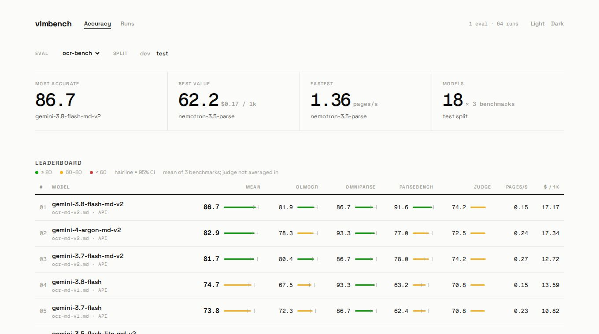

<div align="center">
<p align="center" style="width: 100%;">
    <br>
</p>
<h2>vlmbench</h2>
<p><b>Speed and accuracy for any vision-language model, from one CLI.</b></p>
<p align="center">
<a href="https://pypi.org/project/vlmbench/"></a>
<a href="https://pypi.org/project/vlmbench/"></a>
<a href="https://www.pepy.tech/projects/vlmbench"></a><br>
<a href="https://github.com/vlm-run/vlmbench/blob/main/LICENSE"></a>
<a href="https://discord.gg/AMApC2UzVY"></a>
<a href="https://twitter.com/vlmrun"></a>
</p>
</div>

Pick a VLM with numbers, not vibes: how fast it runs on your hardware, how well it reads your documents, and what
each page costs, all in one place.

- **Speed**: throughput, TTFT, TPOT, latency percentiles and VRAM, swept across concurrency.
- **Accuracy**: public benchmarks graded by their own packages, plus configurable LLM judges, with 95% intervals.
- **Any model**: a local vLLM / Ollama server it starts for you, the VLM Run gateway, OpenRouter, or any
  OpenAI-compatible API.
- **One dashboard**: a leaderboard, per-model profiles and throughput runs on a single HTML page.



## Quick start

```bash
uvx vlmbench run -m Qwen/Qwen3-VL-2B-Instruct -i ./images/ --concurrency 4,8,16   # speed
uv sync --extra evals && vlmbench eval benchmarks/ocr-bench                       # accuracy
vlmbench dashboard                                                                 # see it all
```

## Speed: `vlmbench run`

```bash
uvx vlmbench run -m qwen3-vl:2b -i ./images/                                       # macOS, Ollama
uvx vlmbench run -m Qwen/Qwen3-VL-8B-Instruct -d hf://vlm-run/FineVision-vlmbench-mini --max-samples 64
uvx vlmbench run --profile deepseek-ocr -i ./pages/                                # a model's serve args + prompt
uvx vlmbench run -i ./images/ --base-url https://api.example.com/v1 --api-key $KEY  # a remote API
uvx vlmbench compare                                                               # results side by side
```

| Flag | |
|---|---|
| `-m` / `--profile` | model id, or a bundled profile (`vlmbench profiles`) |
| `-i` / `-d` | files, folders, URLs (images, PDFs, video) or `hf://` dataset |
| `--concurrency` | one value or a sweep: `4,8,16,32` |
| `--backend` | `auto`, `ollama`, `vllm`, `vllm-openai:<tag>` |
| `--base-url`, `--api-key` | any OpenAI-compatible endpoint |
| `--upload` | push results to [`vlm-run/vlmbench-results`](https://huggingface.co/datasets/vlm-run/vlmbench-results) |

Results land in `~/.vlmbench/benchmarks/` as JSON. `vlmbench run --help` lists the rest.

## Accuracy: `vlmbench eval`

A benchmark is a folder of YAML, validated by pydantic:

```
configs/gemini-3.8-flash.yaml                        kind: Serve   how to reach the model
benchmarks/ocr-bench/ocr-bench.yaml                  kind: Eval    models × datasets × judges
benchmarks/ocr-bench/ocr-bench-gemini-3.8-flash.yaml kind: Serve   extends the config, sets the prompt
benchmarks/ocr-bench/prompts/ocr-md-v2.md                          versioned prompts
benchmarks/ocr-bench/judges/faithfulness.yaml        kind: Metric  an LLM judge
```

```yaml
# benchmarks/ocr-bench/ocr-bench-gemini-3.8-flash.yaml
kind: Serve
extends: ../../configs/gemini-3.8-flash.yaml
request:
  prompt: prompts/ocr-md-v2.md
  max_tokens: 16384
```

```bash
vlmbench lint -v                                               # every config loads; ids, prompts
vlmbench eval benchmarks/ocr-bench                             # every model × every dataset
vlmbench eval benchmarks/ocr-bench -s gemini-3.8-flash --split dev   # tune prompts on dev pages
vlmbench board benchmarks/ocr-bench                            # latest scores in the terminal
```

- **Datasets**: OmniParseBench, olmOCR-bench, ParseBench, each graded by its own package; a new benchmark is one
  module in `vlmbench/evals/datasets/`.
- **Honest splits**: `dev` pages for tuning, disjoint `test` pages for reporting; scores carry 95% bootstrap
  intervals.
- **Cached**: replies are cached on disk by config and page, so re-grading or adding a model calls nothing twice.
- **Local and remote**: local vLLM models run one at a time on a free GPU; API models run in parallel, rate-paced.
- **One record**: `result.json` joins performance and accuracy on (`model_id`, `config_id`).
- **Traced**: with `LOGFIRE_TOKEN` set, every eval, dataset, request, grade and judge is a `vlmbench.*` span.
- **Checked on commit**: a pre-commit hook runs `vlmbench lint` on `configs/` and `benchmarks/`.

## Dashboard: `vlmbench dashboard`

One self-contained page over everything collected, served on port 8795 (`--host` to share it).

- **Accuracy**: headline numbers, a sortable leaderboard coloured green / yellow / red (≥ 80 / 60–80 / < 60), and
  a radar per model; hover a row to spotlight it.
- **Runs**: eval throughput per model and dataset, and every `vlmbench run` sweep.

## Install

```bash
pip install vlmbench               # speed
pip install 'vlmbench[evals]'      # + accuracy evals (ParseBench grading needs Python 3.12)
```

As a [Claude Code](https://docs.anthropic.com/en/docs/claude-code) plugin:
`/plugin marketplace add vlm-run/vlmbench`, then `/plugin install vlmbench@vlm-run/vlmbench`.

Requires Python ≥ 3.11. Local serving: Docker with NVIDIA GPUs (or native vLLM) on Linux, Ollama on macOS;
`tmux` for server logs, `ffmpeg` for video.
